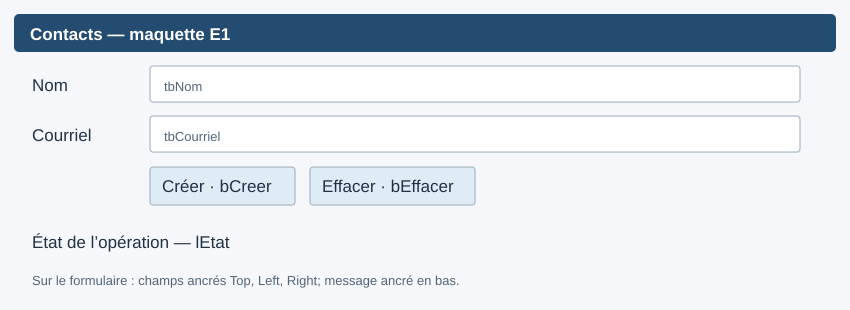

# Exercice 1

**Formatif — 60 minutes.** Construire une fiche de création de contact, puis la relier au cas d'utilisation déjà programmé. Cette interface sera conservée à l'Exercice 2.

## Départ et périmètre

Ouvrir la solution `S09E01E02_Contacts.slnx` dans le dossier [S09E01E02_Contacts](S09E01E02_Contacts/README.md), sous Windows avec Visual Studio et .NET 10. Le formulaire initial est vide. Les projets domaine, Application, Infrastructure JSON, Terminal et Tests sont fournis. Le fichier `Program.cs` du projet WinForms fournit la configuration, l'injection et les deux assemblages; aucun de ces éléments n'est à programmer.

Modifier uniquement `FormContacts.cs` et construire les contrôles avec le designer du projet `S09E01E02_Contacts.WinForms`. Visual Studio mettra à jour `FormContacts.Designer.cs` et, au besoin, son fichier de ressources. Ne pas recopier de règles dans le formulaire, ne pas y instancier `Contact` et ne pas y écrire du JSON.

Créer depuis la branche Git `dev` une branche `fonctionnalite/contacts-winforms`, puis conserver cette branche pour E2. [Rappel Git](../semaine-03/README.md).

## 1. Observer le parcours fourni — 10 min

Exécuter les commandes du [README du départ](S09E01E02_Contacts/README.md), depuis le dossier contenant la solution : compilation, tests filtrés E1, puis terminal. Le terminal crée un contact et le relit; un second lancement avec le même courriel produit un refus. Le fichier est relatif au dossier de l'exécutable, pas au dossier du terminal. La console et WinForms ont donc par défaut leurs propres fichiers.

Repérer `DemandeCreationContact`, le cas d'utilisation `CreerContact.Executer(...)` et `Result<ContactDto>`. La demande transporte `Nom` et `Courriel`, même vides; le cas d'utilisation renvoie alors un refus attendu. Il refuse également un courriel déjà utilisé, sans distinction de casse. Aucune validation complexe d'adresse n'est demandée.

Les tests `Etape=E1` doivent réussir dès le départ. Les neuf cas de tests `Etape=E2` échouent volontairement avec `NotImplementedException` jusqu'à E2-R : ne pas programmer cette méthode maintenant.

## 2. Construire la fiche — 25 min

La maquette indique les zones et les noms; les dimensions exactes ne sont pas imposées.

| Contrôle | Name | Text ou usage |
|---|---|---|
| Label | `lNom` | `&Nom :` |
| TextBox | `tbNom` | Saisie du nom |
| Label | `lCourriel` | `C&ourriel :` |
| TextBox | `tbCourriel` | Saisie du courriel |
| Button | `bCreer` | `&Créer` |
| Button | `bEffacer` | `&Effacer` |
| Label | `lEtat` | Message lisible, sur plusieurs lignes si nécessaire |

Utiliser un conteneur pour aligner les champs. Ordre de tabulation : nom, courriel, Créer, Effacer. Donner une taille minimale à la fenêtre et laisser les champs s'élargir. Utiliser `bCreer` comme `AcceptButton`.

La méthode `InitializeComponent()` construit les contrôles; le gestionnaire du clic se trouve dans l'autre partie de la classe. Relier une seule fois `bCreer.Click` à `bCreer_Click` et `bEffacer.Click` à `bEffacer_Click`. Le chargement du formulaire est déjà relié; il n'a rien à faire en E1.

## 3. Transmettre la demande — 15 min

Compléter ces trois méthodes du fichier `FormContacts.cs` :

| Repère | Méthode | Travail |
|---|---|---|
| E1-C | `bCreer_Click` | Construire `DemandeCreationContact` depuis les deux champs; appeler `Creation.Executer(demande)`; vérifier `EstSucces` avant `Valeur`; afficher le nom créé ou `MessageErreur` |
| E1-E | `EffacerSaisie` | Vider les deux champs et placer le focus sur `tbNom` |
| E1-M | `AfficherMessage` | Affecter le texte à `lEtat.Text` |

Le bouton Effacer appelle déjà les deux dernières méthodes. Après un refus, garder la saisie et placer le focus sur le champ à corriger. Les blocs `catch` et la méthode `SignalerIncident` sont fournis : garder leur message sûr et leur journalisation. Ne pas afficher `exception.Message`.

Les repères E2 restent intacts. Après une création réussie en E1, afficher la confirmation; l'effacement automatique et la liste seront ajoutés en E2.

## 4. Vérifier — 10 min

Sans écrire de nouveaux tests ni de compte rendu :

- Créer un contact et observer le succès après l'enregistrement.
- Essayer un nom vide ou un courriel vide : refus, champs conservés.
- Réutiliser le même courriel en majuscules : refus, pas de deuxième contact.
- Utiliser Effacer, Tab, Entrée et les touches d'accès; vérifier le focus et agrandir la fenêtre.
- Compiler à nouveau et exécuter les tests `Etape=E1` fournis.

Le domaine et la persistance peuvent être testés sans fenêtre. Le designer, le clavier et le redimensionnement s'observent sous Windows; une compilation croisée sur macOS ne les prouve pas.

**Fin observable :** une fiche fonctionnelle qui appelle le cas d'utilisation fourni et distingue succès, refus et incident. Conserver ce travail pour [l'Exercice 2](E02-gestion-contacts.md).
