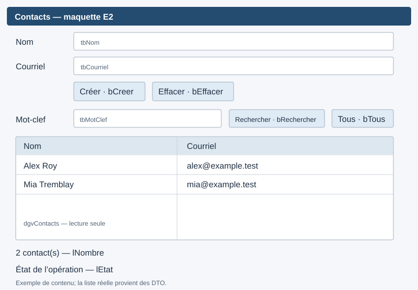

# Exercice 2

**Ramassé — 4 heures.** Reprendre le formulaire de l'Exercice 1, sans reconstruire sa fiche, pour afficher et rechercher les contacts enregistrés. Les modalités de remise, l'échéance et la pondération restent celles de la plateforme.

## Périmètre et fichiers

Continuer la solution [S09E01E02_Contacts.slnx](S09E01E02_Contacts/S09E01E02_Contacts.slnx) du dossier `semaine-09/S09E01E02_Contacts` et la branche Git `fonctionnalite/contacts-winforms` utilisées en [E1](E01-fiche-contact.md).

- Présentation à compléter : `FormContacts.cs` et contrôles du designer, projet `S09E01E02_Contacts.WinForms`.
- **Une seule méthode hors présentation à écrire :** `DepotContactsJson.Rechercher(string motClef)`, projet `S09E01E02_Contacts.Infrastructure`, bloc `E2-R`.
- Application, domaine, conversions DTO, lecture/écriture JSON, cas de consultation, configuration, injection, journal et tests : déjà programmés. Aucun autre trou à combler dans ces couches.

Pas de modification ni suppression, pas de fenêtre secondaire obligatoire, pas de portée à programmer, pas de nouveau test ni de document de justification à écrire. Ne pas ajouter de fonctionnalité qui empiète sur le temps de raccordement et de vérification.

## 1. Recherche du dépôt — 20 min

Dans le fichier `DepotContactsJson.cs`, conserver la garde contre `null`, la normalisation par `Trim()` et l'appel à `Lire()` situés avant `E2-R`. Remplacer seulement le bloc qui lance `NotImplementedException` par le filtrage et le retour de la collection.

| Entrée / situation | Contrat |
|---|---|
| Mot-clef présent dans le nom **ou** le courriel | Retourner le contact, une seule fois |
| Casse différente | Comparer avec `StringComparison.OrdinalIgnoreCase` |
| Espaces au début ou à la fin | Les ignorer |
| Chaîne vide ou blanche | Retourner tous les contacts |
| Aucune correspondance | Retourner une collection vide |
| Plusieurs correspondances | Conserver l'ordre du dépôt |
| Toute recherche | Ne modifier ni les contacts ni le fichier |

La garde `ArgumentNullException.ThrowIfNull` et la lecture JSON validée sont fournies. Ne pas les déplacer, ne pas faire de `WriteAllText` et ne pas changer le contrat pour rendre les tests verts. Les entités fournies sont immuables. Une séquence filtrée peut être matérialisée avant son retour.

<details>
<summary>Rappel ciblé : chercher une sous-chaîne</summary>

API utiles : `string.Contains(string, StringComparison)`, `Where`, `ToArray`. [Révision S1](../semaine-01/README.md). Question de diagnostic : tester seulement le nom couvre-t-il tous les cas du contrat?
</details>

Dans l'**Explorateur de tests de Visual Studio**, sélectionner les tests du groupe `E2` (trait `Etape`) et les exécuter. Les neuf cas de recherche doivent maintenant réussir.

## 2. Enrichir l'interface — 80 min



Garder la zone de création d'E1. Ajouter :

| Contrôle | Name | Usage |
|---|---|---|
| Label | `lMotClef` | Libellé du mot-clef |
| TextBox | `tbMotClef` | Saisie de recherche |
| Button | `bRechercher` | `&Rechercher` |
| Button | `bTous` | `&Tous` |
| DataGridView | `dgvContacts` | Colonnes Nom et Courriel depuis les DTO |
| Label | `lNombre` | Nombre de contacts affichés, ou « Aucun résultat » |

Définir la grille en lecture seule : `ReadOnly=true`, `AllowUserToAddRows=false`, `AllowUserToDeleteRows=false`. Utiliser deux colonnes explicites (`DataPropertyName` : `Nom`, `Courriel`) avec `AutoGenerateColumns=false`, ou une projection de DTO ne contenant que ces deux propriétés. Ne pas afficher l'identifiant technique.

Conserver les contrôles d'E1 sur le formulaire et agrandir celui-ci pour ajouter la recherche et les résultats. Poursuivre avec `Anchor` :

- `tbMotClef` : `Top, Left, Right`.
- `bRechercher` et `bTous` : `Top, Right`.
- `dgvContacts` : `Top, Bottom, Left, Right` pour utiliser l'espace disponible.
- `lNombre` et `lEtat` : `Bottom, Left, Right`.

Garder les libellés, un ordre de tabulation cohérent et les touches d'accès. Une confirmation ou erreur reste compréhensible sans couleur. Il n'est pas demandé d'introduire un conteneur de disposition.

## 3. Raccorder les événements — 80 min

Dans `FormContacts.cs`, les méthodes et les blocs de traitement des incidents sont déjà présents :

| Repère | Méthode | Comportement attendu |
|---|---|---|
| E2-L | `FormContacts_Load` | Afficher `Consultation.ObtenirTous()` à l'ouverture; traiter un incident avec le mécanisme fourni |
| E2-S | `bRechercher_Click` | Appeler `Consultation.Rechercher(tbMotClef.Text)` puis afficher les DTO |
| E2-T | `bTous_Click` | Afficher tous les contacts et vider le mot-clef |
| E2-A | `AfficherContacts` | Alimenter la grille, actualiser `lNombre`, y compris pour zéro résultat |
| E2-C | Succès de `bCreer_Click` | Vider nom/courriel et mot-clef, afficher tous les contacts, redonner le focus au nom |

Relier les deux nouveaux clics une seule fois. Le formulaire ne filtre pas lui-même les contacts : il appelle le cas de consultation fourni. N'utiliser `Valeur` qu'après un succès de création.

Après un refus ou un incident de création, préserver les champs. Après un incident de consultation, afficher le message technique sûr fourni; ne pas remplacer la grille par une fausse liste vide. Une création réussie est déjà enregistrée : si l'actualisation échoue ensuite, indiquer « Contact créé; actualisation impossible » plutôt qu'inciter à recréer ce contact.

## 4. Vérifier — 40 min

Dans **Visual Studio**, générer la solution puis exécuter tous les tests dans l'Explorateur de tests. Les **34 tests** doivent réussir : les 25 tests E1 et les neuf cas E2. Aucun échec n'est attendu après la réalisation de `E2-R`.

Définir `S09E01E02_Contacts.WinForms` comme projet de démarrage et lancer avec **Démarrer**, sans argument supplémentaire. Le terminal et WinForms utilisent des fichiers distincts par défaut, dans le dossier de leur exécutable respectif.

Réaliser ensuite sous Windows :

1. Ouvrir avec un dépôt vide; créer au moins trois contacts; fermer et relancer pour vérifier la relecture.
2. Chercher par nom, par courriel, avec casse différente, puis avec espaces aux extrémités.
3. Chercher une chaîne vide, puis une chaîne sans correspondance : vérifier grille et compteur.
4. Revenir à Tous; créer alors qu'un filtre est actif : tous les contacts réapparaissent et les champs sont vidés.
5. Essayer un champ vide puis un courriel dupliqué : saisir, refuser et corriger sans perdre le reste.
6. Vérifier un incident avec l'enseignant sur une copie de données, puis rétablir la configuration et réessayer. Ne jamais exposer le chemin ou la trace technique dans l'UI.
7. Vérifier que les cellules ne sont pas modifiables, qu'un clic ne déclenche qu'une action, puis clavier, focus, redimensionnement et designer. [Protocole Windows détaillé](VERIFICATION_WINDOWS.md).

## 5. Marge et remise — 20 min

Vérifier les modifications, puis intégrer la branche de fonctionnalité dans `dev` selon les consignes Git antérieures et les modalités de la plateforme. Ne pas inclure `bin`, `obj`, les fichiers de données personnels ou les journaux. Aucun rapport supplémentaire n'est demandé.

**Fin observable :** une fiche conservée d'E1, une liste de contacts persistés, une recherche par nom ou courriel et un compteur cohérent; une seule méthode du dépôt a été ajoutée hors présentation.

<details>
<summary>Si vous préférez la ligne de commande — facultatif</summary>

Depuis le dossier `semaine-09/S09E01E02_Contacts`, qui contient la solution `.slnx` :

```bash
dotnet build S09E01E02_Contacts.slnx
dotnet test S09E01E02_Contacts.slnx
dotnet run --project S09E01E02_Contacts.WinForms
```

Ces commandes remplacent les manipulations dans Visual Studio; il n'est pas demandé de faire les deux.

</details>
