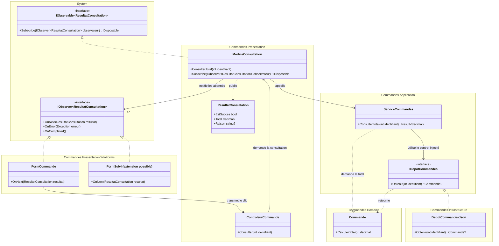

# MVC avec Observateur en .NET

Dans la démo, seul `FormCommande` affiche le résultat de la consultation. Le diagramme présente aussi `FormSuivi` comme extension possible. Le contrôleur transmet la demande au modèle. Le modèle appelle le service applicatif et publie le résultat à ses observateurs.

La démonstration est une occasion de montrer quelques éléments de réusinage et de séparation des responsabilités. Le service applicatif est indépendant de la présentation et du stockage. Le domaine porte le calcul du total, et le dépôt JSON porte la lecture. Elle est un peu artificielle pour illustrer le patron Observateur mais reste fonctionnelle.

La consultation est synchrone et laisse la commande intacte. Le modèle de présentation publie le résultat de la lecture dès qu’elle se termine. Un retour direct suffirait pour un seul formulaire. L’abonnement sert ici à illustrer le patron Observateur et permettrait à une deuxième vue de réagir au même résultat. 

## Projets et espaces de noms

| Projet | Espace de noms | Rôle |
|---|---|---|
| `Commandes.WinForms` | `Commandes.Presentation.WinForms` | Formulaire et assemblage des objets au démarrage |
| `Commandes.Presentation` | `Commandes.Presentation` | Contrôleur, modèle observable et résultat de présentation |
| `Commandes.Application` | `Commandes.Application` | Service de consultation et contrat du dépôt |
| `Commandes.Domaine` | `Commandes.Domaine` | Entité `Commande` et calcul du total |
| `Commandes.Infrastructure` | `Commandes.Infrastructure` | Dépôt JSON et conversion vers le domaine |

## Diagramme de classes

`FormCommande` hérite de `System.Windows.Forms.Form` et implante directement `IObserver<ResultatConsultation>`. Un éventuel `FormSuivi` pourrait implanter la même interface et s’abonner au même modèle. Le modèle est le sujet du patron et implante `IObservable<ResultatConsultation>`. Les triangles creux en pointillé indiquent l’implantation d’une interface.

## Du clic à la notification

1. Au démarrage, `Program.cs` crée le dépôt JSON et l’injecte dans `ServiceCommandes` sous le type `IDepotCommandes`. Il crée ensuite le modèle, le contrôleur et `FormCommande`.
2. `Program.cs` abonne le formulaire avec `modele.Subscribe(vue)` et libère l’`IDisposable` retourné à la sortie de la boucle WinForms.
3. `FormCommande` transmet le numéro au contrôleur. Le contrôleur appelle `ModeleConsultation.ConsulterTotal`. Le modèle demande le résultat au service.
4. Le service demande la commande au dépôt par `IDepotCommandes.Obtenir`. Si la commande existe, le service lui demande de calculer son total. Le domaine porte le calcul et Infrastructure porte la lecture JSON.
5. Le modèle transmet le même `ResultatConsultation` à chaque vue abonnée avec `OnNext`. Un résultat contient soit un total, soit la raison de l’échec. Chaque formulaire choisit son affichage.

Une commande introuvable ou un incident de lecture devient un résultat d’échec transmis par `OnNext`. `OnError` et `OnCompleted` signalent la fin du flux. Le modèle peut donc publier le résultat de la prochaine consultation après un échec.

La référence au dépôt concret se trouve au démarrage. La couche Application déclare le contrat `IDepotCommandes`, et Infrastructure fournit la classe qui l’implante.
